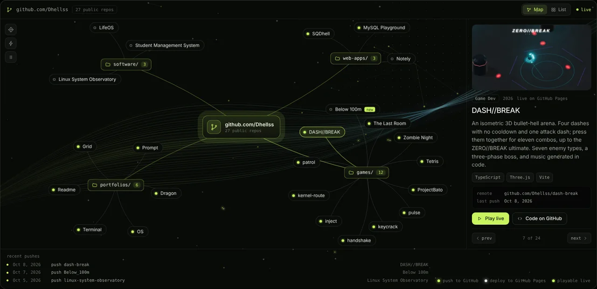

# Network

A one-page portfolio where every project I've built is a node wired to my GitHub. Drag the nodes around, hover one to trace its link, and click it to open the project.

**Live:** https://dhellss.github.io/Network/



## What's on the page

- **Home:** a terminal that types out who I am, an ID card, what I do, and the tools I use.
- **Projects:** 24 projects grouped into folders and linked to github.com/Dhellss. Lime packets are pushes to GitHub and white packets are deploys to GitHub Pages. There is also a list view, and on phones the map becomes a file tree.
- **Contact:** Gmail, GitHub and LinkedIn with copy buttons, plus a small TCP handshake animation.

The background is a canvas particle network that connects to your cursor, with a light stream that shifts as you scroll. When the GitHub API is reachable, the page refreshes push dates and the repo count on its own. All motion turns off for visitors who have reduced motion enabled.

## Run it locally

Keep `index.html`, `style.css`, `script.js` and the `assets/` folder together, then open `index.html` in a browser, or right-click it in VS Code and choose **Open with Live Server**. There is no build step and nothing to install. The fonts load from Google Fonts, so they need an internet connection; without one the page uses system fonts.

## Files

```
index.html   page structure
style.css    design tokens, layout and responsive rules
script.js    background, terminal, project network and handshake
assets/      photo, preview image and project screenshots (WebP)
```

## Add a project

Add an entry to the `PROJECTS` list near the top of `script.js`, then put a screenshot in `assets/projects/` named after the entry's `id` (for example `assets/projects/my-game.webp`).

Built with HTML, CSS and JavaScript (Canvas 2D), no libraries.
